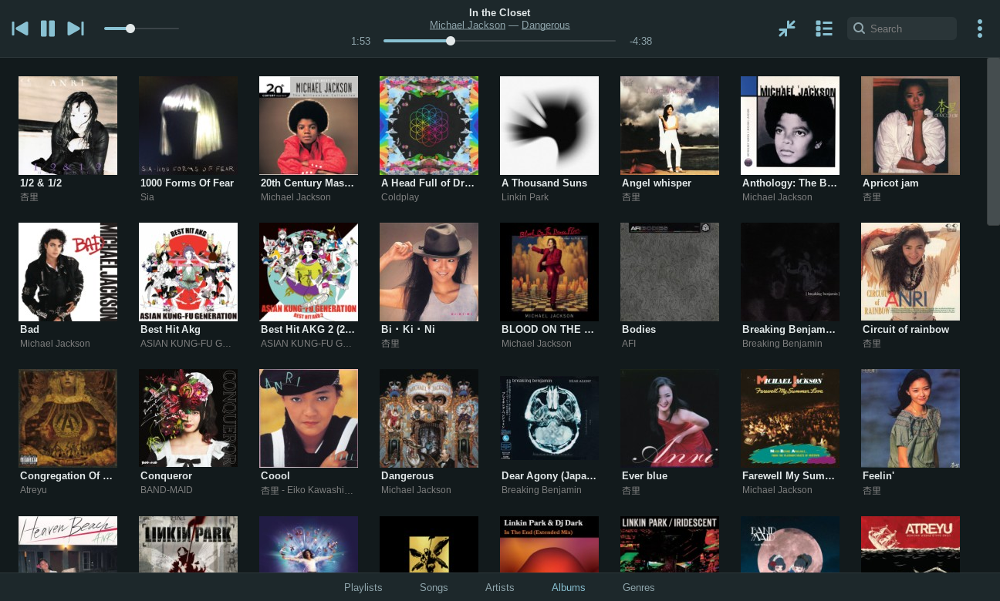
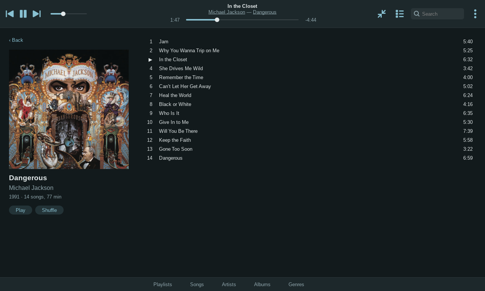
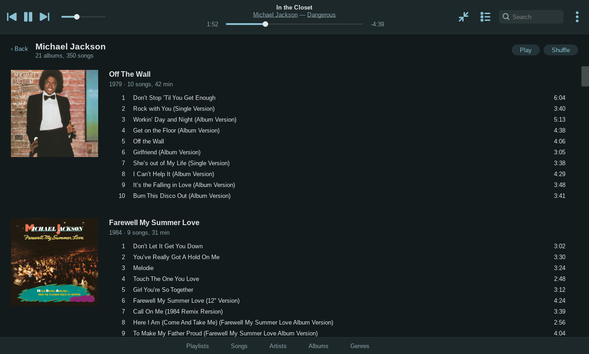
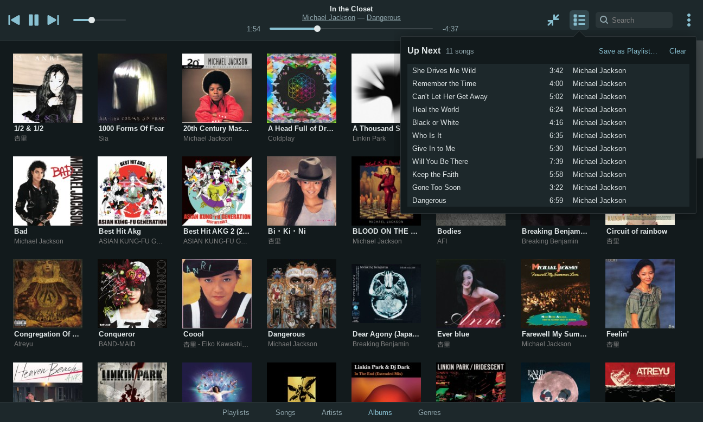
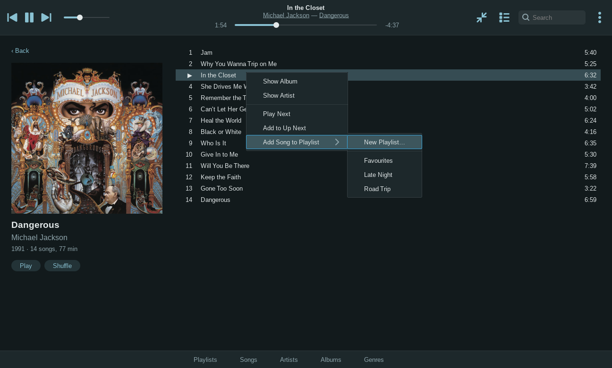
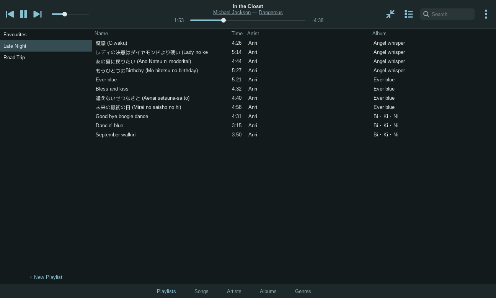
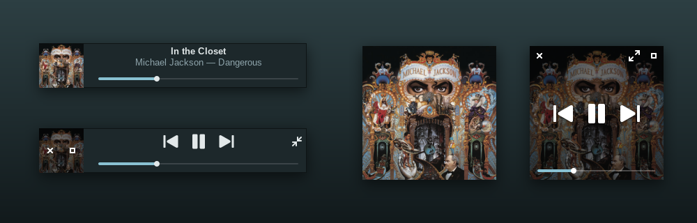
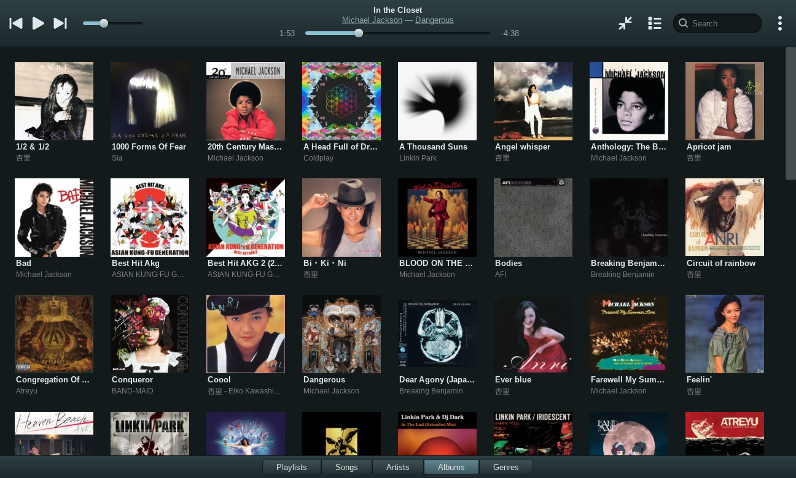
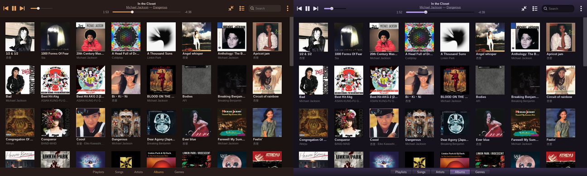

# Ember

A music player for [Kindling](https://github.com/LukeM-99/Kindling) in the style of the iPad Music app before it became Apple Music: an album grid, tabs for Playlists, Songs, Artists and Genres, album and artist pages, and an iTunes-style mini player. [MPD](https://www.musicpd.org/) plays the music and keeps the library; Ember is a small GTK3 frontend written in C, so it stays light on old machines, and it is themed from your wallpaper. It needs only GTK3 and libmpdclient, and runs MPD as your user, so it works without systemd.



## Requirements

- **Debian 12 (bookworm) or Devuan 5 (daedalus), or newer**, with `apt`. Older releases lack the GLib and MPD versions Ember needs; `install.sh` checks and stops.
- **X11.** Under Wayland the mini player can't keep its place or stay above other windows.
- It is built for [Kindling](https://github.com/LukeM-99/Kindling) and works without it, using your GTK theme instead of the wallpaper palette.
- Your music in `~/Music`. MPD reads tags and cover art from the files (embedded art, or `cover.jpg` and friends in the album folder).

## Install

```
git clone https://github.com/LukeM-99/Ember.git ember
cd ember
./install.sh        # then start Ember from the app launcher, or run: ember
```

Read `install.sh` before you run it. It:

- Runs `sudo apt install` for `mpd`, the build tools, `libgtk-3-dev`, `libmpdclient-dev` and `curl`. If MPD isn't installed yet, it holds back service starts while installing it (`policy-rc.d`), then disables the system MPD with `update-rc.d`: Ember runs MPD as you, not as a system daemon. An MPD that was already installed is left as it is.
- Builds Ember with `make`.
- Symlinks into `~` from the clone: `~/.config/mpd/mpd.conf`, `~/.local/bin/ember`, the launcher entry `~/.local/share/applications/ember.desktop` and its icon. Anything already there that is not a symlink is moved to `~/.dotfiles_backup/<date>/` first.
- **Already have an MPD setup?** If `~/.config/mpd/mpd.conf` or `~/.mpdconf` is yours, it is kept and Ember's config is not linked. Point Ember at your MPD with `MPD_HOST` (see Settings); Ember then never starts or stops MPD, and closing it only pauses the music.

Because the files are symlinks, keep the clone where it is.

The first start builds MPD's database from `~/Music`; with a few thousand songs that takes seconds.

## Uninstall

```
rm -f ~/.local/bin/ember ~/.local/share/applications/ember.desktop ~/.local/share/icons/hicolor/scalable/apps/ember.svg ~/.config/mpd/mpd.conf
rm -rf ~/.config/ember ~/.cache/ember ~/.local/share/mpd    # settings, cover cache, MPD's database and playlists
```

The apt packages stay; remove them yourself if you no longer want them.

## Using it

The top bar has the transport, volume, shuffle, repeat (off, all, one) and now playing; the artist and album under the song are links to their pages. On the right: the mini player, Up Next, search and the ⋯ menu. The tabs along the bottom are **Playlists · Songs · Artists · Albums · Genres**.

Double-click a song to play it: the list it is in becomes the queue, as on the iPod. Click an album cover for its songs on a card over the grid, with Play and Shuffle; its album and artist names open their pages. Type anywhere to search every view; Esc clears it.

<p> </p>

**Album and artist pages.** Click the album or artist name under the playing song, or right-click a song, an album or an artist for Show Album and Show Artist. ‹ Back returns to the tab you were on. The playing song is marked ▶ in every list.

<p> </p>

**Up Next and the right-click menu.** The list button shows the songs after the current one: double-click to jump, right-click to remove, Clear to empty the rest (the current song keeps playing), or Save as Playlist. Right-click songs, an album or an artist for Play Next, Add to Up Next and Add to Playlist.

<p></p>

**Playlists** are MPD's own, kept in `~/.local/share/mpd/playlists`. Right-click one to play, rename or delete it. MPD can't store an empty playlist, so a new one waits in Ember until its first song is added.



**Mini and micro players**, after iTunes 11. The arrows-in button (or Ctrl+Shift+M) swaps the window for the mini player: cover, song and progress, with the controls on hover. Shrink it again for the micro player, just the cover. Both float above other windows, drag anywhere to move, and reopen where you left them.

## Styles and theming

Two looks on the same layout, picked in the ⋯ menu:

- **Flat** (default): flat bars, hairline dividers, controls in the accent colour, text tabs.
- **Classic**: gradient bars, embossed icons, a segmented tab control, a pill-shaped search field.



Colours come from Kindling's palette (`~/.cache/kindling/colors`). Pick a new wallpaper and Ember restyles itself within a second. Album covers follow Kindling's UI scale.



## Shortcuts

| Key | |
|---|---|
| Space | play / pause |
| Ctrl+← / Ctrl+→ | previous / next |
| Shift+← / Shift+→ | back / forward 10 s |
| Ctrl+↑ / Ctrl+↓ | volume up / down |
| Ctrl+F, or just type | search |
| Ctrl+1 … Ctrl+5 | Playlists, Songs, Artists, Albums, Genres |
| Delete | remove the selected songs from Up Next or the playlist |
| Ctrl+Shift+M | mini player and back |
| Ctrl+Q | quit |

Media keys work through MPRIS, which Ember provides itself: `playerctl`, and so Kindling's media keys, control it, and notifications get the song and cover.

## Settings

The ⋯ menu; they are kept in `~/.config/ember/settings`, along with the window size and tab Ember reopens with.

- **Style**: Flat or Classic. `EMBER_STYLE=classic ember` tries one without saving it.
- **Keep Playing After Ember Closes**: off by default. Closing Ember then pauses the music and shuts down Ember's own MPD, which saves its place and resumes there, paused, next time. Media keys only reach MPD while Ember runs.
- **Show What's Playing on Discord**: off by default. "Listening to *artist*", with the song, the album and a progress bar. Ember talks only to the Discord app on your machine (Discord, Vesktop, Flatpak or Snap); paused, stopped or quitting clears it.
- **Look Up Album Covers Online (for Discord)**: off by default. Discord can only show a picture by URL, so this asks [MusicBrainz](https://musicbrainz.org/) for the album (the artist and album names are sent) and points Discord at the [Cover Art Archive](https://coverartarchive.org/)'s front cover. Each album is looked up once and remembered in `~/.cache/ember/coverart`. Without it Discord shows the Ember logo.

While the Discord and cover switches are off, those modules (`src/discord.c`, `src/coverart.c`) do nothing at all: no socket, no network, no helper processes.

`MPD_HOST` points Ember at another MPD: `MPD_HOST=localhost ember`, or the path of its socket (`MPD_HOST=/run/mpd/socket ember`). To make it stick, add `export MPD_HOST=...` to your `~/.profile`. Album covers need MPD 0.22 or newer and Play Next 0.23.

## Why MPD

Ember first set out to drive cmus. MPD fits a graphical player better:

| | MPD | cmus |
|---|---|---|
| Designed as | a headless server for any client | a terminal UI you can also control remotely |
| Change events | pushed (`idle`) | none: the client polls |
| Library queries | indexed (`find`, `search`, `list`) | the whole library dumped each time |
| Album art | served (`albumart`, `readpicture`) | none: the client reads the files |
| Headless | `mpd` daemonises | needs a hidden terminal |
| C client library | `libmpdclient`, in Debian | none |

## How it works

- C, GTK3 (already loaded for Firefox and pcmanfm) and libmpdclient; about 3,000 lines in `src/`. Ember itself uses about 30 MB; the rest is shared GTK.
- No polling. The MPD connection waits in `idle` and the UI redraws only when MPD reports a change; the clock ticks once a second, only while playing.
- Covers come from MPD on a worker thread with its own connection, are shrunk once and cached in `~/.cache/ember/covers/`, and only the albums on screen are asked for.
- MPD runs as you: `config/mpd.conf` keeps everything in `~/.local/share/mpd` and listens on a socket, not TCP. Ember starts it if it isn't running.

An AppImage isn't offered: Ember needs MPD, a separate service, so a single file would have to carry MPD and its decoders (40–60 MB) and would miss Debian's security updates.

## Licence

GPL-3.0, the same as Kindling. See `LICENSE`.
